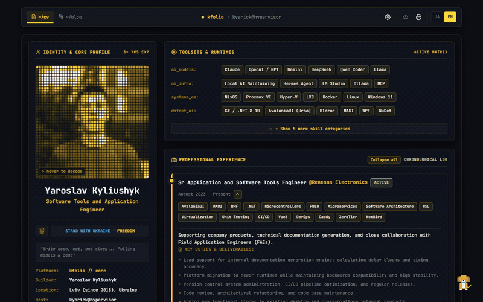
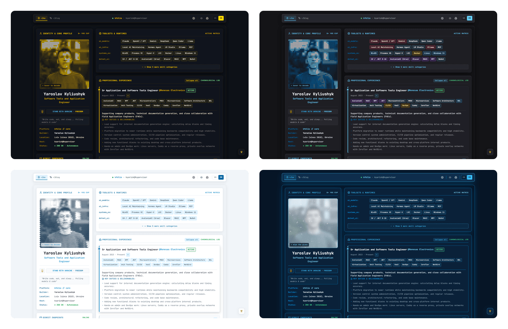
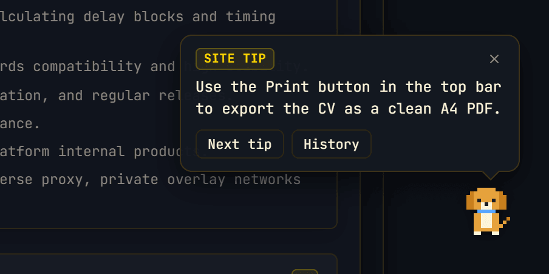
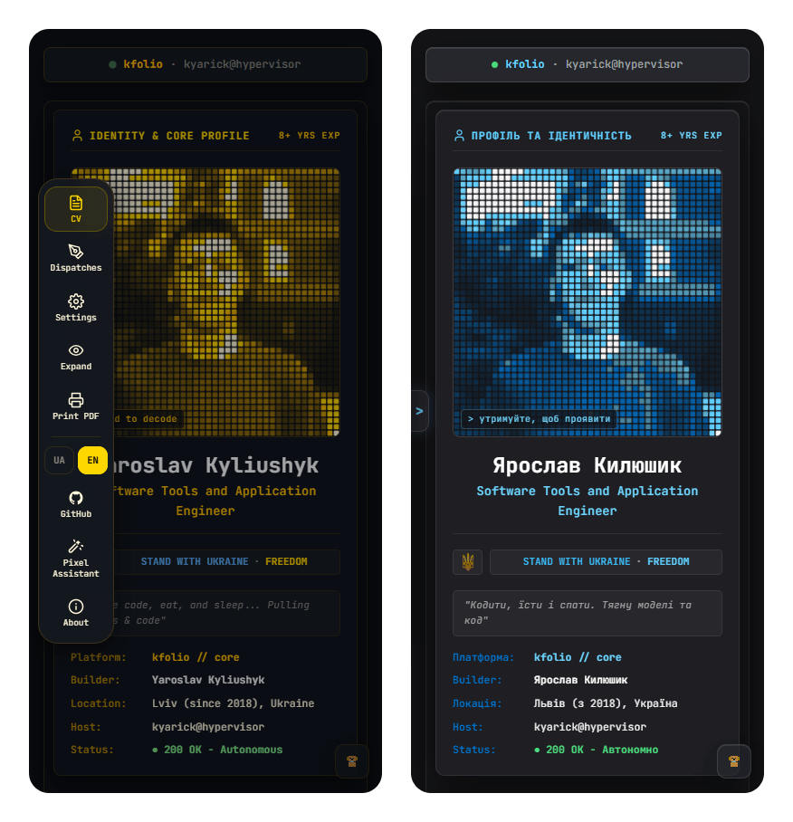

<div align="center">
  

[](https://github.com/kYaRick/kfolio/actions/workflows/deploy.yml)
[](https://astro.build)
[](https://www.typescriptlang.org/)
[](https://github.com/casey/just)
[](https://pnpm.io/)
[](LICENSE)

</div>

> Interactive bilingual CV and engineering dispatches styled after the **Hermes Agent** console (`kYa.Camilla.Agent`).

<div align="center">
  <a href="https://kyarick.github.io/kfolio/"><b>Live site</b></a> ·
  <a href="https://kyarick.github.io/kfolio/en/blog/">Dispatches</a> ·
  <a href="https://kyarick.github.io/kfolio/llms.txt">llms.txt</a> ·
  <a href="https://kyarick.github.io/kfolio/llm.json">llm.json</a>
  <br><br>
  
</div>

---

## Highlights and Features

- 🛰️ **Hermes Terminal Aesthetic:** Bento dashboard layout, pixel vector trident emblem, telemetry widgets, and terminal window controls inspired by `kYa.Camilla.Agent`.
- 🎨 **Multi-Theme Engine:**
  - `hermes-dark` (Default: gold, amber, obsidian CLI console)
  - `fluent-dark` (Microsoft Fluent 2 Acrylic / Mica with vibrant colored technology tags)
  - `hermes-light` (Clean high-contrast paper slate mode for recruiters)
  - `seasonal-winter` (Frost and ice core with dynamic snowfall)
- 🌐 **Bilingual (i18n):** Native Astro static routing for English (`/en/`) and Ukrainian (`/uk/`) with persistent UI dictionaries.
- 📝 **Markdown Content Layer:** Type-safe CV collections and blog dispatches validated via Zod schemas.
- 🖨️ **Print and PDF Engine:** One-click print export with automatic accordion expansion, customizable section toggles, and A4-optimized pagination.
- 🐕 **Pixel Assistant:** A tiny companion that serves site tips and fresh Hacker News headlines, keeps a history log, and dresses up for winter.
- 🤖 **Agent API:** Static `llms.txt`, `llm.json` and `/api/*.json` endpoints expose the CV, skills, experience, contacts and blog to AI agents.
- 🔗 **URL Parameters:** Deep links such as `?theme=fluent-dark`, `?settings=effects`, `?about=1`, `?mode=full` and `?dog=0`.
- 📱 **Mobile Edge Panel:** Draggable side handle with quick navigation, settings, print, language and assistant toggles.
- ⚡ **SSG Performance:** High-speed static generation with Astro ClientRouter, telemetry loading bars, and zero heavy client frameworks.

---

## Screenshots

<p align="center">
  
  <br><sub><code>hermes-dark</code> · <code>fluent-dark</code> · <code>hermes-light</code> · <code>seasonal-winter</code></sub>
</p>

<table>
  <tr>
    <td width="54%" align="center">
      
      <br><sub>Pixel assistant</sub>
    </td>
    <td width="46%" align="center">
      
      <br><sub>Mobile edge panel · EN / UK</sub>
    </td>
  </tr>
</table>

---

## Agent API

Every endpoint is generated at build time, so agents get the same data as the page, with no server.

```bash
curl -s https://kyarick.github.io/kfolio/llm.json
```

| Endpoint | Content |
| :--- | :--- |
| [`/llms.txt`](https://kyarick.github.io/kfolio/llms.txt) | Human-readable entry point for LLM crawlers |
| [`/llm.json`](https://kyarick.github.io/kfolio/llm.json) | Discovery index: summary and endpoint directory |
| [`/api/agent.json`](https://kyarick.github.io/kfolio/api/agent.json) | Full bundle: CV, blog, URL parameters |
| [`/api/cv.json`](https://kyarick.github.io/kfolio/api/cv.json) · [`skills`](https://kyarick.github.io/kfolio/api/skills.json) · [`experience`](https://kyarick.github.io/kfolio/api/experience.json) · [`contacts`](https://kyarick.github.io/kfolio/api/contacts.json) · [`blog`](https://kyarick.github.io/kfolio/api/blog.json) | Focused slices, `en` and `uk` |

---

## Tech Stack

- **Framework:** [Astro 7](https://astro.build/)
- **Language:** TypeScript (Strict Nullable Types, Zero-Warning Policy)
- **Task Runner:** [just](https://github.com/casey/just)
- **Content:** Astro Content Layer (Markdown + Zod schemas)
- **Styling:** Modern Vanilla CSS (Custom Properties, Bento Grid, Terminal Theming)
- **Package Manager:** `pnpm`
- **CI/CD:** GitHub Actions -> GitHub Pages

---

## Local Development (with `just`)

All routine operations run via `just`:

```bash
# List all available recipes
just

# Install dependencies (frozen lockfile, same as CI)
just setup

# Start local dev server with hot reload (http://localhost:4321/kfolio/)
just dev

# Type-check .astro and .ts files (zero-warning policy)
just check

# Build static production bundle into dist/
just build

# Preview built dist/ locally
just preview

# Remove build artifacts and Astro caches
just clean

# Full verification gate (check + build)
just ci

# Regenerate README media (banner PNG, screenshots, demo GIF)
# Needs Edge/Chromium and ffmpeg; run `just preview` in another terminal first
just media
```

---

<div align="center">
  <sub>✨ Made with love to 💛Ukraine💙</sub>
</div>
